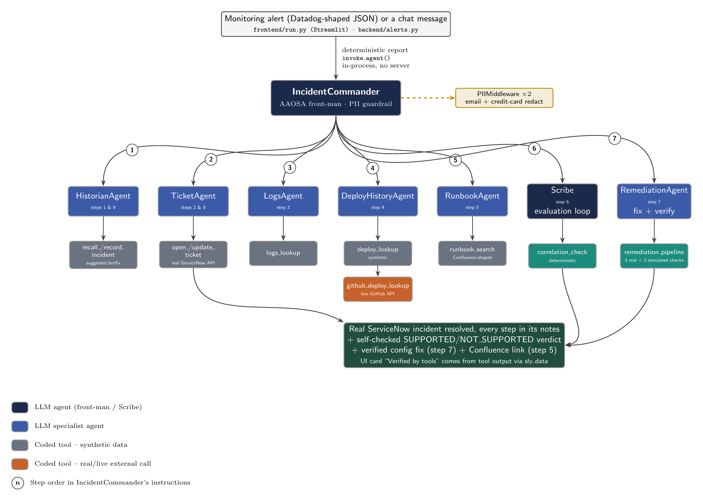

# Sentinel

An AI incident-triage assistant for on-call engineers. A monitoring alert comes in; a team of cooperating agents
pulls the logs, the recent deploys and the matching runbook, opens a ServiceNow-style ticket, **self-checks its
root-cause hypothesis with a deterministic correlation test**, suggests the known hotfix and resolves the ticket.
Built with Cognizant's [neuro-san](https://github.com/cognizant-ai-lab/neuro-san) multi-agent framework.



---

## Prerequisites

- Python **3.12+** (tested on 3.14). Note: some systems still default `python` to 3.11 - check `python --version`.
- An [OpenAI API key](https://platform.openai.com/api-keys). The default models are `gpt-4o-mini` with
  `gpt-4.1-mini` as automatic fallback. (Any OpenAI-compatible provider works, see
  [Using another provider](#using-another-provider-eg-openrouter).)

---

## Setup

### 1. Clone the repository

```sh
git clone <repo-url>
cd sentinel-agent
```

### 2. Create and activate a virtual environment

```sh
python -m venv .venv
source .venv/bin/activate        # macOS / Linux
# .venv\Scripts\activate         # Windows
```

### 3. Install dependencies

```sh
pip install -r requirements.txt
```

### 4. Set your API key

Create a `.env` file in the project root (loaded automatically via `python-dotenv`; it is git-ignored):

```sh
echo "OPENAI_API_KEY=sk-..." > .env
```

(See `.env.example` for the optional overrides.)

---

## Running the App

### Validate the agent configuration (optional but recommended)

```sh
python -m neuro_san.client.hocon_validator_cli backend/registries/sentinel.hocon
```

### Launch the Streamlit web interface

```sh
streamlit run frontend/run.py
```

Open the printed URL (usually `http://localhost:8501`). Pick a sample alert and press **Investigate alert**;
Sentinel composes the incident report from the alert payload. The page shows the ServiceNow ticket and the
**Verified by tools** evidence produced by deterministic tools. A run takes roughly one minute.

You can also just type, for example:

- `checkout-service is throwing 500 errors with NullPointerException on PaymentValidator.charge() since 14:02 UTC on 2026-10-12, what's going on?`
- `inventory-service is timing out when querying warehouse_db, help me triage this.`
- a follow-up in the same conversation: `Which deploy caused this and who authored it?` (reuses the same ticket)

### Fire an alert from the command line

```sh
python backend/alerts.py --preset checkout-500
# other presets: checkout-500-with-pasted-pii, payments-gateway-timeout, inventory-timeout
python backend/alerts.py --payload path/to/your_alert.json    # any Datadog-monitor-shaped JSON
```

### Run the backend directly (headless smoke test)

```sh
python backend/run.py
```

### Run the checkout demo app

The separate `checkout-demo-app` repository is a tiny local service with a visible fault switch and Prometheus metrics.
Start it first from its folder:

```sh
docker compose up -d --build
```

Open `http://localhost:8000`, inject the checkout fault, and generate a realistic burst of 100 virtual shoppers:

```sh
docker compose --profile load run --rm k6
```

### Run Prometheus and Alertmanager locally

The Streamlit process also starts a token-protected webhook receiver at `http://localhost:8090/alerts/alertmanager`.
To try the full Prometheus → Alertmanager → Sentinel → ServiceNow path:

1. Configure a random `SENTINEL_WEBHOOK_TOKEN` (at least 24 characters) in `.env`, set
   `SENTINEL_WEBHOOK_HOST=0.0.0.0`, and copy the same token into `.secrets/sentinel_webhook_token`.
2. Start the Streamlit app using the command above.
3. From the repository root, run `docker compose -f docker-compose.alerting.yml up -d`.
4. Open Prometheus at `http://localhost:9090` and Alertmanager at `http://localhost:9093`. Prometheus scrapes the
   checkout app's measured 5xx counter; Alertmanager forwards the firing alert to Sentinel.
5. Stop the stack with `docker compose -f docker-compose.alerting.yml down`.

The checkout app and its traffic are synthetic, while Prometheus metrics, alert routing, GitHub PRs/Actions and
ServiceNow records use their real APIs. The webhook requires a bearer token, caps request size and alert count, accepts firing alerts only, and suppresses
duplicate Alertmanager retries by fingerprint. The receiver binds to `0.0.0.0` for Docker Desktop connectivity;
keep the token private and use a firewall or a private container network for non-demo deployments.

### Human-reviewed GitHub repair

Create a GitHub repository from the local `checkout-demo-app` folder and configure these variables in Sentinel's
local `.env`: `SENTINEL_GITHUB_TOKEN`, `SENTINEL_DEMO_GITHUB_OWNER`, `SENTINEL_DEMO_GITHUB_REPO`, and optionally
`SENTINEL_DEMO_APP_URL` / `SENTINEL_DEMO_APP_CONFIG_PATH`. Use a fine-grained token scoped only to the demo repo
with Contents read/write, Issues read/write, Pull requests read/write, and Checks read. After an incident opens a
ticket, choose **Prepare repair PR** in Sentinel. Sentinel creates a GitHub issue first, then a branch and PR that
links the issue with `Closes #N`. GitHub closes the issue only when the human-approved PR is merged. The UI fetches and
displays the actual issue, diff and Actions results. The merge button stays disabled until checks pass and a human
checks the approval box. After merge, Sentinel syncs only the reviewed `app/settings.json` file into the local demo
app, verifies a checkout request, then resolves the linked ServiceNow ticket.

### Run the tests and the evaluation harness

```sh
pytest                      # fast, offline tests of the coded tools (no LLM calls)
python eval/run_eval.py     # 13 live scenarios through the real network (~10 min, uses API credits)
```

The harness writes `eval/_reports/report.md`. It grades each run on the **deterministic tool outputs** in the
agent trace (correlation verdict, runbook match, ticket opened, hotfix computed), not on the LLM's prose, and restores
the runtime data files afterwards so the working tree stays clean.

---

## Real ServiceNow tickets (optional)

With a free [ServiceNow Personal Developer Instance](https://developer.servicenow.com), Sentinel creates and resolves
**real incidents** instead of local ones. Add to `.env` (never commit it):

```sh
SERVICENOW_INSTANCE=dev12345            # or the full https://dev12345.service-now.com
SERVICENOW_USER=admin
SERVICENOW_PASSWORD=<your instance password>
```

Optional: `SERVICENOW_ASSIGNMENT_GROUP` (default `Software`), `SERVICENOW_CALLER`, `SERVICENOW_ASSIGNEE`,
`SERVICENOW_CLOSE_CODE` (default `Solution provided`; must match a Resolution code on your instance). The Streamlit
ticket panel shows a link to the live record the moment it exists, then fills in work notes as the agents investigate,
propose a fix, and wait for your approval. Wake a hibernating PDI from the developer portal first.

### The demo scenario

Inject the fault in the checkout demo app and run the 100-user k6 profile: measured app metrics trigger Prometheus
and Alertmanager -> Sentinel investigates and opens a ServiceNow ticket -> Streamlit prepares a GitHub PR and shows
its actual diff and Actions checks -> you approve and merge -> Sentinel applies the allow-listed config, verifies
checkout, and resolves the incident. The ticket remains open until that human-approved recovery completes.

---

## Project Structure

```
sentinel-agent/
├── backend/
│   ├── run.py                      # Backend entry point; exposes invoke_agent()
│   ├── alerts.py                   # Alert payload -> incident report (deterministic) + CLI
│   ├── sample_alerts/              # Datadog-shaped sample alerts
│   ├── registries/
│   │   ├── manifest.hocon          # Active agent registry
│   │   ├── sentinel.hocon          # Multi-agent network definition
│   │   ├── llm_config.hocon        # Shared LLM config (OpenAI, two-model fallback chain)
│   │   ├── aaosa_basic.hocon       # AAOSA protocol instructions (unmodified copy from neuro-san-studio, Apache-2.0)
│   │   └── expertise_scoping_instructions.hocon   # (same origin)
│   └── coded_tools/sentinel/       # CodedTools (plain Python) + data/ (synthetic JSON fixtures)
├── frontend/
│   └── run.py                      # Streamlit UI: chat + alert presets + ticket panel
├── ops/
│   ├── prometheus/                  # Prometheus scrape and demo alert rule
│   └── alertmanager/                # Authenticated Alertmanager webhook route
├── docker-compose.alerting.yml      # Local Prometheus + Alertmanager demo stack
├── eval/                           # 13-scenario automated evaluation harness
├── tests/                          # pytest suite for the coded tools
├── docs/diagrams/                  # TikZ/LaTeX sources and rendered diagrams
├── requirements.txt                # Python dependencies
├── architecture.md                 # System architecture
├── summary.md                      # Project summary
└── README.md                       # This file
```

---

## How It Works

The backend is a **multi-agent network** defined declaratively in `backend/registries/sentinel.hocon`:

| Agent | Role |
|-------|------|
| `IncidentCommander` | Front man. Routes the incident through the other agents; PII guardrail (email/credit-card redaction) sits on it |
| `HistorianAgent` | Persistent memory: recalls prior incidents and returns a `suggested_hotfix`; records new incidents |
| `TicketAgent` | Opens one ServiceNow-style ticket per incident; it remains open while a fix awaits human PR review |
| `LogsAgent` / `DeployHistoryAgent` / `RunbookAgent` | Independent specialists over logs, deploys (synthetic + one live GitHub-backed source) and Confluence-shaped runbooks |
| `RemediationAgent` | Proposes a fix and runs local preflight checks; GitHub Actions and human approval gate merge and resolution |
| `Scribe` | Synthesizes the answer, but only after the deterministic `correlation_check` tool re-derives the timestamps and grades the hypothesis |

See [architecture.md](architecture.md) and [summary.md](summary.md) for the details and the evaluation evidence.

---

## Dependencies

| Package | Purpose |
|---------|---------|
| neuro-san (0.7.7) | Multi-agent orchestration framework (pulls in langchain, langchain-openai, pyhocon, ...) |
| streamlit | Web chat interface |
| python-dotenv | `.env` file support |
| requests | GitHub REST call in `github_deploy_lookup` |
| pytest | Test suite |
| pyyaml | Reads and patches the service config in the fix-and-verify stage |

---

## Using another provider (e.g. OpenRouter)

Everything is configured through environment variables / `.env`, no code changes:

```sh
OPENAI_API_KEY=<your OpenRouter key>
OPENAI_API_BASE=https://openrouter.ai/api/v1
SENTINEL_PRIMARY_MODEL=openai/gpt-4o-mini
SENTINEL_FALLBACK_MODEL=anthropic/claude-haiku-4.5      # a cross-provider fallback chain
```

To make the GitHub-backed deploy-history tool read your own fork instead of its offline cache, set
`GITHUB_REPO_OWNER` and `GITHUB_REPO_NAME`.

---

## Troubleshooting

**`OPENAI_API_KEY` not found / authentication errors** - the key must be in `.env` in the project root or exported in
your shell. The app loads `.env` itself; neuro-san does not.

**HOCON validation error** - run the validator command above and fix the reported line in
`backend/registries/sentinel.hocon`. Note `include` paths are relative to the repository root; `backend/run.py`
switches to it automatically, but if you run neuro-san tooling yourself, do it from the repo root.

**Rate-limit / `429` / "credits" errors** - the fallback chain tries the second model automatically; if both
fail, check your provider quota.

**Garbled or crashing output on Windows** - set `PYTHONUTF8=1` before running other tools; the provided entry points
already force UTF-8 output.

**Port already in use** - `streamlit run frontend/run.py --server.port 8502`

---

## License and attribution

Apache License 2.0 (see `LICENSE`). Built on [neuro-san](https://github.com/cognizant-ai-lab/neuro-san) (Cognizant AI
Lab, Apache-2.0). `aaosa_basic.hocon` and `expertise_scoping_instructions.hocon` are unmodified copies from
[neuro-san-studio](https://github.com/cognizant-ai-lab/neuro-san-studio) and keep their original license headers. All
data (logs, deploys, runbooks, tickets, incident history) is synthetic and written for this project.
