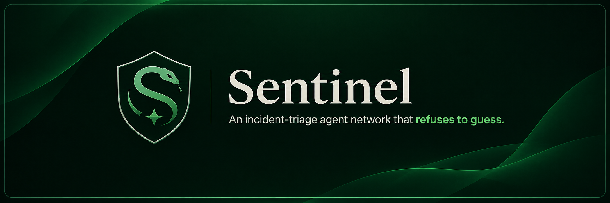
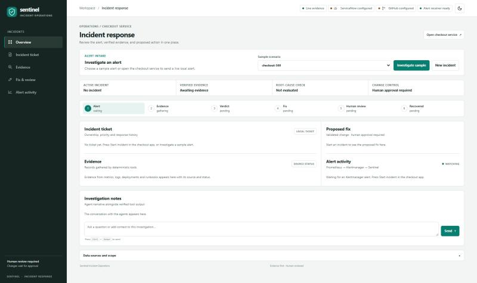

<p align="center">
  
</p>

[](requirements.txt)
[](https://github.com/cognizant-ai-lab/neuro-san)
[](registries/sentinel.hocon)
[](tests/)
[](extras/docker-compose.app.yml)
[](#license)

**An incident-triage agent network that refuses to guess.** An alert fires; a team of neuro-san agents gathers logs,
metrics, deploy history and runbook evidence; a *deterministic* check decides whether the evidence supports a root
cause; Sentinel opens a ticket and proposes a bounded fix that a **human** reviews and merges.

> LLMs route and explain. Coded tools decide. Every piece of evidence is labelled `fixture`, `live` or `unavailable`.

Built on Cognizant's [neuro-san](https://github.com/cognizant-ai-lab/neuro-san) framework (agents declared in HOCON).

<p align="center">
  
</p>

## 60-second demo

```sh
python -m venv .venv && .venv\Scripts\activate        # macOS/Linux: source .venv/bin/activate
pip install -r requirements.txt
# Configure OPENAI_API_KEY in .env using .env.example; preserve any existing .env.
python apps/sentinel/web.py
```

Open http://localhost:8501, keep the `checkout-500` sample selected and press **Investigate alert** (about a minute).
You get a ticket, a `SUPPORTED` verdict re-derived from source timestamps (deploy v2.14.0 landed 4.0 min before the
errors), the runbook, and a locked-until-supported **Prepare repair PR** panel. Pick `inventory-timeout` instead to see
Sentinel say `NOT_SUPPORTED` rather than invent a cause.

By default Sentinel runs in **demo mode**: bundled evidence is replayed from `coded_tools/sentinel/data/` and labeled
`fixture`. Agent reasoning still uses the configured LLM API and may incur charges. Native Python startup loads `.env`;
use the local-safe Docker workflow below when external ticket/repair writes must be disabled.

## Live mode (optional)

Set `SENTINEL_MODE=live` in `.env` to switch the evidence tools to real sources:

| Evidence | Demo mode (default) | Live mode |
|---|---|---|
| Metrics | fixture | Prometheus HTTP API |
| Logs | fixture | Grafana Loki |
| Deploys | fixture | GitHub Deployments + statuses |
| Runbooks | fixture | Confluence (read-only) |
| Tickets | local SQLite | local SQLite, mirrored to ServiceNow if configured |

The Prometheus/Alertmanager/Loki stack and containers live in [extras/](extras/); see
[extras/LOCAL_ALERTING_DEMO.md](extras/LOCAL_ALERTING_DEMO.md) and [extras/OPERATIONS.md](extras/OPERATIONS.md).
The human-reviewed GitHub repair PR needs `SENTINEL_GITHUB_TOKEN` and a demo repo (see `.env.example`); the *Prepare repair
PR* button creates a real issue and PR in that repo.

For the full containerised stack (one PowerShell wrapper that combines the alerting, app, Loki and Alloy Compose
files with a local-safe override), see **[docs/DOCKER.md](docs/DOCKER.md)**.

## How the network works

```
IncidentCommander (front man, PII guardrail)
 ├─ Responder ........ open_ticket · recall_incidents · finalize_incident · update_ticket
 ├─ LogsAgent ........ loki_logs
 ├─ MetricsAgent ..... prometheus_metrics
 ├─ DeployHistoryAgent github_deployments · deploy_lookup
 ├─ RunbookAgent ..... runbook_search
 └─ Scribe ........... correlation_check   (deterministic evaluation loop)
```

- **[registries/sentinel.hocon](registries/sentinel.hocon)** is the single source of truth for agents, tool routing,
  middleware and `sly_data` exposure. Python only starts the network.
- **[coded_tools/sentinel/](coded_tools/sentinel/)** holds the deterministic tools. Tools publish evidence into
  `sly_data`; `correlation_check` re-derives the incident and deploy timestamps from that evidence itself instead of
  trusting timestamps retold by an LLM.
- **`finalize_incident`** is the close-out tool: it records incident memory and, only for a `SUPPORTED` verdict, prepares
  the allow-listed config fix with local preflight checks. The ticket stays *In Progress* until a human approves the PR.
- Details, diagrams and design rationale: [docs/ARCHITECTURE.md](docs/ARCHITECTURE.md).

## Repository layout

```
registries/        HOCON agent network (manifest, sentinel, llm_config, AAOSA includes)
coded_tools/sentinel/   deterministic tools, evidence schemas, stores, data/ fixtures
apps/sentinel/     web.py + web/ (responsive HTML UI), run.py (neuro-san bootstrap), alerts.py, alertmanager_receiver.py
tests/             offline pytest suite (no LLM, no network)
eval/              opt-in live LLM scenarios (uses API credits)
scripts/           compose wrapper, preflight, telemetry check, secret scan, live demo driver
extras/            optional ops: Docker, Prometheus/Alertmanager/Loki/Alloy, webhook service, ops runbooks
docs/              architecture, summary, setup guides, diagrams; archive/ holds superseded plans
```

## Documentation

| Read this | If you want to |
|---|---|
| [docs/SUMMARY.md](docs/SUMMARY.md) | understand the problem and the idea in five minutes |
| [docs/ARCHITECTURE.md](docs/ARCHITECTURE.md) | see the agent network, diagrams and the request flow |
| [docs/JUDGE_DEMO_SCRIPT.md](docs/JUDGE_DEMO_SCRIPT.md) | run the presentation demo step by step |
| [docs/DOCKER.md](docs/DOCKER.md) | run the full containerised live-mode stack |
| [extras/LOCAL_ALERTING_DEMO.md](extras/LOCAL_ALERTING_DEMO.md) · [extras/OPERATIONS.md](extras/OPERATIONS.md) | set up Prometheus/Alertmanager and operate the containers |
| [docs/CONFLUENCE_LIVE_SETUP.md](docs/CONFLUENCE_LIVE_SETUP.md) · [docs/CHECKOUT_DEMO_PREREQUISITES.md](docs/CHECKOUT_DEMO_PREREQUISITES.md) | connect live Confluence or the checkout demo app |
| [extras/SECURITY_AND_RETENTION.md](extras/SECURITY_AND_RETENTION.md) | review the safety and data-retention model |
| [docs/PLAN.md](docs/PLAN.md) · [docs/CHECKPOINT_LOG.md](docs/CHECKPOINT_LOG.md) | see the completion plan and verification evidence |

## Tests

```sh
pytest                      # unit/integration tests; observed results are in docs/CHECKPOINT_LOG.md
python eval/run_eval.py     # live scenarios (~10 min, uses API credits)
python -m neuro_san.client.hocon_validator_cli registries/sentinel.hocon
```

## Safety model

Fixed, allow-listed repair scope; PR head SHA and checks re-verified before merge; no auto-merge; PII redaction on the
front man; secrets only in the git-ignored `.env`. See [extras/SECURITY_AND_RETENTION.md](extras/SECURITY_AND_RETENTION.md).

Ticket mutations require the private incident session to own the ticket. Fingerprint retries reuse its canonical
session. The HTML repair API requires `ticket_number` for PR creation; merge and recovery requests also require
the reviewed integer `pr_number` and full `sha` from `/api/state`, with `approved: true` for merge. Stale or missing
bindings are rejected; API callers must send these fields. Recovery after merge stays pinned to the reviewed ticket
even if another incident becomes active. These checks do not provide user authentication or distributed job locking.

## License

Apache-2.0. `aaosa_basic.hocon` and `expertise_scoping_instructions.hocon` are unmodified copies from
[neuro-san-studio](https://github.com/cognizant-ai-lab/neuro-san-studio). Fixtures are synthetic.
