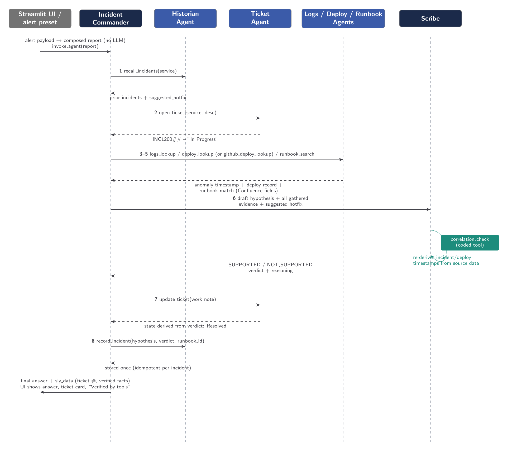

# Architecture

## Overview

Sentinel is an **AI incident-triage assistant** built on Cognizant's **neuro-san** framework. When a production
alert fires, an on-call engineer normally spends the first critical minutes correlating logs, recent deploys and old
runbooks by hand. In the current demo, Sentinel runs a coordinated network of agents over live Prometheus metrics,
local Loki logs, explicit GitHub Deployments for the checkout service, and JSON fixtures for other deploy
history, runbooks, incident memory, and local tickets. It
deterministically checks whether tool-published log evidence and deployment data support a cause and can propose a
narrow repair for the isolated checkout demo app. When the
corresponding integrations are configured, it can also query explicit deployment records, show commit history as
context only, create/review a PR in a
dedicated demo repository, and mirror tickets to a ServiceNow instance. A human reviews the actual diff and GitHub
Actions checks in Streamlit; only the allow-listed local demo setting is applied after approval and recovery checks.

The system is a **Streamlit web frontend**, a thin **Python backend** that runs the agent network in-process, and a
**multi-agent network** (eight agents and their coded tools) declared in one HOCON file.

---

## System Architecture Diagram


*Step numbers match the order in `IncidentCommander`'s instructions (`backend/registries/sentinel.hocon`). Grey tool
boxes read small synthetic JSON fixtures; `github_deployments` reads explicit GitHub Deployment records and status
events for checkout-service. The legacy `github_deploy_lookup` is commit-history context only. Diagram
sources (TikZ) are in `docs/diagrams/`; rebuild with `pdflatex architecture.tex && pdftoppm -png -r 200 -singlefile
architecture.pdf architecture`.*

---

## Component Breakdown

### 1. Frontend - `frontend/run.py`

A **Streamlit** app that:

- Lets the user type an incident **or fire a sample monitoring alert** from the sidebar. The alert is a
  Datadog-monitor-shaped JSON payload; `backend/alerts.py` turns it into an incident report deterministically (plain
  Python, no LLM), because a real on-call engineer does not hand-write a precise query during an outage.
- Keeps `chat_context` **and** `sly_data` in Streamlit session state, so follow-up questions continue the same
  conversation and reuse the same ticket instead of opening a new one.
- Shows a local ticket or, when configured, the ServiceNow **ticket link and ownership**, a **"Verified by tools"** card, and a human-review panel with
  the GitHub issue link, real PR diff, Actions checks and an explicit approve-and-merge control.

### 2. Backend - `backend/run.py`

- Loads `.env`, switches to the repository root (HOCON `include` paths resolve against the working directory) and
  sets `AGENT_MANIFEST_FILE`, `AGENT_TOOL_PATH` and `PYTHONPATH` so neuro-san finds the registry and the coded tools.
- Exposes `invoke_agent(user_text, sly_data, chat_context)`, which uses neuro-san's `DirectAgentSessionFactory` to run
  the network **in-process** (no separate server) and returns the final response (`text`, `chat_context`, `sly_data`).
- After each run, `_ensure_incident_recorded()` makes the memory write **idempotent and guaranteed**: the Historian
  agent is asked to record the incident, but if the model skipped or repeated the call, the app records it exactly once.

### 3. Agent registry - `backend/registries/`

| File | Purpose |
|------|---------|
| `manifest.hocon` | Lists the active network |
| `sentinel.hocon` | Defines every agent, its instructions and its tool wiring |
| `llm_config.hocon` | Shared LLM config: OpenAI `gpt-4o-mini` with `gpt-4.1-mini` as fallback (env-overridable) |
| `aaosa_basic.hocon`, `expertise_scoping_instructions.hocon` | The AAOSA protocol text the agents include (unmodified upstream copies) |

### 4. The multi-agent network - `sentinel.hocon`

| Agent | Type | Role |
|-------|------|------|
| `IncidentCommander` | LLM agent (front man) | Entry point. Decides, at runtime, to consult the others in order. Carries two `PIIMiddleware` guardrails (email, credit card) that redact sensitive data before any agent or the LLM sees it |
| `RemediationAgent` | LLM agent | After a SUPPORTED root cause, calls `remediation_pipeline` for a proposed patch and local preflight; the GitHub PR and CI are handled by the human-review workflow |
| `HistorianAgent` | LLM agent | Persistent memory across conversations. Recalls prior incidents and returns a `suggested_hotfix` when the service has recurred; records new incidents |
| `TicketAgent` | LLM agent | Opens a local ticket and optionally mirrors it to ServiceNow when configured; resolution waits for merge and recovery verification |
| `LogsAgent` | LLM agent | Finds the anomaly and its timestamp from bounded Loki results (`loki_logs`); fixture fallback is opt-in |
| `DeployHistoryAgent` | LLM agent | Uses explicit GitHub Deployment records for checkout-service; fixture records for other demo services; commit history remains context only |
| `RunbookAgent` | LLM agent | Finds a synthetic fixture runbook shaped like a Confluence page (`runbook_search`) |
| `Scribe` | LLM agent | Writes the summary, but only after calling `correlation_check` |

### 5. Coded tools - `backend/coded_tools/sentinel/`

Plain Python classes extending neuro-san's `CodedTool`: `loki_logs`, `prometheus_metrics`, `logs_lookup` (explicit fixture fallback), `deploy_lookup`, `github_deployments`, `github_deploy_lookup` (commit context only), `runbook_search`,
`correlation_check`, `recall_incidents`, `record_incident`, `open_ticket`, `update_ticket`, `remediation_pipeline`, plus
helpers: `servicenow_client` (Table API), `ticket_notes`, `service_names` (fuzzy service-name canonicalization),
`verified_facts` and the JSON-backed `ticket_store` / `incident_memory_store`. `github_deployments` reads a bounded
page of explicit deployment records and their latest statuses. It reports live/empty when the configured repository
and environment have no records; it never substitutes commits or build runs.

---

## ServiceNow integration

`open_ticket` / `update_ticket` always keep the local store and, when `SERVICENOW_INSTANCE`, `SERVICENOW_USER` and
`SERVICENOW_PASSWORD` are set, mirror to the real instance through the Table API (`backend/coded_tools/sentinel/servicenow_client.py`):
the incident is created In Progress with impact/urgency derived from the priority, a caller, an assignment group and an
assignee (an active member of that group, because instances commonly enforce membership); every later step adds a work
note; resolution sets state 6 with a close code and close notes. An unreachable instance never breaks triage: the
ticket stays local and the failure is noted on it. Credentials live only in the git-ignored `.env`.

## Human-reviewed fix-and-verify stage

`remediation_pipeline` refuses unless `correlation_check` is SUPPORTED. It prepares a proposed diff and local
preflight results; it does not alter a running service or claim CI results. When the user chooses **Prepare repair PR**,
the Streamlit panel creates a GitHub issue first, then a dedicated branch and PR that links the issue with GitHub's
`Closes #N` keyword. It displays the live issue state, actual diff and check runs. The merge button remains disabled
until checks pass and the user explicitly approves. GitHub closes the linked issue on merge. Sentinel then
synchronizes only the allow-listed settings file to the localhost demo app, clears the fault, verifies a checkout
request, records the outcome in ServiceNow, and resolves the ticket. No arbitrary code execution or deployment to a
production service is performed.

## Agentic System Highlights

- **LLM-driven routing (AAOSA).** There is no hard-coded pipeline: the front man reads the incident and calls the
  specialists it needs through neuro-san's AAOSA protocol.
- **A deterministic evaluation loop.** `correlation_check` re-derives the incident and deploy timestamps itself from
  source data and verifies the deploy happened shortly *before* the anomaly on the *same* service. The Scribe cannot
  present a root cause the data does not support. (An early version trusted timestamps relayed through several LLM
  hops; the model occasionally garbled them, which is why the tool re-derives everything.)
- **Verified facts channel.** Tools publish what they actually found into `sly_data` (neuro-san's private control
  channel). The front man is allowed to return it upstream, so the UI renders the verdict, runbook and hotfix from tool
  output. This matters: in testing, the model's *prose* once cited the wrong runbook id while the verified card was right.
- **Deterministic state transitions.** The ticket stays In Progress through investigation and local preflight; only the
  human-approval workflow resolves it after PR merge and recovery verification. `open_ticket` / `record_incident` are idempotent per conversation via
  `sly_data`, so a retried or forgotten model tool call can neither duplicate nor skip them.
- **Persistent memory with action.** Recurrence is not just noted; the Historian returns the known fix to reapply.
- **Guardrails and resilience.** PII redaction middleware on the front man; a two-model LLM fallback chain;
  `max_steps` / `max_execution_seconds` bounds on the network.
- **Declarative configuration.** Topology, instructions, middleware and the LLM chain live in HOCON; the Python is
  only the tools and a thin runner.

---

## Current data-source boundaries

| Evidence or action | Source in the current demo | Status |
|---|---|---|
| Alert | Streamlit sample or local Prometheus/Alertmanager webhook | Sample is local; Prometheus/Alertmanager is a local running stack that sends an alert. |
| Metrics investigation | Read-only Prometheus HTTP API | Live for the configured checkout-service error-rate query, with bounded time range and normalized samples. |
| Logs | Local Grafana Loki via `loki_logs`; Alloy collects checkout container logs | Live and verified; fixture fallback is explicitly opt-in. |
| Deploys | GitHub Deployments API for checkout-service; `data/deploys.json` for other services | Explicit records/statuses only; no records currently exist in the configured checkout repository/environment. Commit history remains context only. |
| Runbooks | `data/runbooks.json` | Synthetic Confluence-shaped fixture; no Confluence API call. |
| Ticket and incident history | JSON stores, optionally mirrored to ServiceNow when configured | Local demo by default; external ServiceNow is optional. |
| Repair PR/checks | Dedicated demo GitHub repository when configured | Real GitHub API path, but only for the demo repair. |
| Recovery | Local checkout demo app and allow-listed settings file | Local demo only; no production deployment. |

## Data Flow



```
User fires an alert (or types an incident) in Streamlit
    -> backend/alerts.py composes the incident report (deterministic)
    -> invoke_agent(report, sly_data, chat_context)      # DirectAgentSessionFactory, in-process
    -> IncidentCommander (PII middleware redacts input)
        1. HistorianAgent -> recall_incidents      => prior incidents + suggested_hotfix
        2. TicketAgent    -> open_ticket           => INC12000xx (In Progress)
        3-6. LogsAgent / MetricsAgent / DeployHistoryAgent / RunbookAgent -> logs, metrics, deploy, runbook
        6. Scribe -> correlation_check              => SUPPORTED / NOT_SUPPORTED (deterministic)
        7. RemediationAgent -> remediation_pipeline => proposed diff + local preflight only
        8. TicketAgent -> update_ticket             => remains In Progress pending human PR merge
    -> user chooses Prepare repair PR
        9. GitHub issue created -> branch/commit -> PR with "Closes #issue"
       10. Actions pass -> human approves merge -> GitHub closes issue
       11. Sentinel applies allow-listed settings -> verifies checkout -> resolves ServiceNow incident
    <- final answer + sly_data (ticket number, verified facts)
Human reviews actual PR diff + Actions checks in Streamlit, then approves merge
Streamlit syncs the reviewed settings, verifies checkout recovery, and resolves ServiceNow
```

---

## Technology Stack

| Layer | Technology |
|-------|-----------|
| Agent framework | [neuro-san](https://github.com/cognizant-ai-lab/neuro-san) 0.7.7 (AAOSA, CodedTool, middleware, LLM fallbacks, `sly_data`) |
| LLM | OpenAI `gpt-4o-mini` (fallback `gpt-4.1-mini`); any OpenAI-compatible provider via env |
| Frontend | Streamlit |
| Agent config | HOCON |
| Custom tools | Python 3 (`CodedTool` interface), JSON fixtures |
| Guardrail | LangChain `PIIMiddleware` |
| Evaluation | pytest (tools) + a live 13-scenario harness driving neuro-san's own CLI client |
| Diagrams | TikZ / LaTeX |
