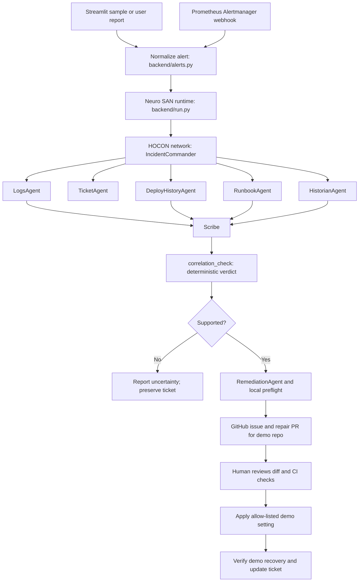

> **Archived.** This was the original enterprise roadmap; paths below predate the restructure (backend/ -> registries/, coded_tools/, apps/sentinel/, extras/). See ../docs/ARCHITECTURE.md for the current design.

# Sentinel: Incremental Architecture and Integration Plan

## 1. Purpose

This document describes what Sentinel currently does, the architecture it should preserve, which integrations are practical, and an incremental implementation sequence. The objective is to make Sentinel a credible, evidence-grounded incident workflow while keeping the Neuro SAN agent network declarative in HOCON and keeping risky decisions deterministic and reviewable.

This is a plan, not a claim that every integration below is already connected. The current project includes both live integrations and synthetic/demo data; each step below calls out that distinction.

## 2. Product goal

**Sentinel receives a structured service alert, gathers attributable operational evidence, checks whether the evidence supports a cause, opens or updates an incident, and prepares a bounded repair proposal for human review.** It should state uncertainty when evidence is incomplete and should never let an LLM's narrative alone authorize a repair or resolve an incident.

### Design rules

1. **HOCON defines the agent network.** Agent roles, tool routing, middleware, and model configuration stay in `backend/registries/`. Python starts the Neuro SAN network and implements deterministic coded tools; it should not grow into a second, hand-coded agent orchestrator.
2. **Tools establish facts; models route and explain.** API clients return structured results with provenance. Deterministic code owns correlation verdicts, deduplication, authorization boundaries, ticket state, and recovery checks.
3. **Every finding has provenance.** Keep source, query/time window, timestamp, record identifier, and a link where available. The UI must distinguish live-source data from fixture/fallback data.
4. **Use adapters and normalized schemas.** Provider-specific response formats stay inside connector tools. Agents use a stable incident/evidence shape.
5. **Read-only first; writes behind gates.** Start integrations with bounded read access. Any repair, merge, ticket resolution, or production action requires explicit policy and human approval.
6. **A demo fallback must be honest.** Fixtures are useful for offline evaluation, but the product must label fixture results and must not present them as live external evidence.

## 3. Current system map



### Existing components and what is real today

| Component | Current implementation | Current data/integration status |
|---|---|---|
| Alert entry | Streamlit samples/free text; `backend/alerts.py` normalizes structured payloads | Sample payloads are local fixtures. |
| Alertmanager intake | `backend/alertmanager_receiver.py` accepts firing Alertmanager alerts, authenticates a bearer token, limits payload size/count, and deduplicates fingerprints | Real webhook interface; the repo includes a Prometheus/Alertmanager Compose stack. |
| Agent runtime | `backend/run.py` uses Neuro SAN `DirectAgentSessionFactory` | Real framework runtime; agent network is in HOCON. |
| Agent registry | `manifest.hocon`, `sentinel.hocon`, `llm_config.hocon` | HOCON defines topology, tool routes, instructions, middleware, and model fallback. |
| LLM provider | OpenAI-compatible client; project `.env` points to OpenRouter in this workspace | Live API key authentication was checked; the documented sample triage completed. The sample run emitted a model-price metadata warning, so Neuro SAN's local cost display may be inaccurate. |
| Logs | `loki_logs.py` queries bounded local Loki; `logs_lookup.py` remains an explicitly enabled fixture fallback | Local Alloy collector is running with approved Docker socket access and filters to the checkout demo service. |
| Deploy history | `deploy_lookup.py` reads labeled local fixtures; `github_deployments.py` reads explicit deployment records and statuses for the checkout repo; `github_deploy_lookup.py` remains commit context | The deployments API is scoped by repository and environment; commits and build runs are excluded from deployment evidence. |
| Runbooks | `runbook_search.py` ranks `runbooks.json` | Synthetic Confluence-shaped fixture; not a Confluence API integration. |
| Incident memory | `incident_memory_store.py` and recall/record tools | Local JSON persistence. |
| Tickets | JSON ticket store; optional `servicenow_client.py` Table API | Can use a real ServiceNow instance when configured; otherwise local demo ticket. Configuration alone does not prove a live instance is reachable. |
| Repair proposal | `remediation_pipeline.py` prepares a patch and deterministic local preflight | Limited to the checkout demo scenario. |
| PR review | `github_pr_client.py` creates/reuses a GitHub issue and PR, reads the diff and checks, and enforces the review gate | Real GitHub API path when configured, scoped to a dedicated demo repo. |
| Recovery | Syncs an allow-listed setting to the local checkout demo, sends recovery/checkout requests, then can resolve the ticket | Local demo app only; this is not a production deploy. |
| Frontend | `frontend/run.py` Streamlit chat, ticket panel, verified-facts panel, and human approval UI | Functional demo UI. |

### Important distinction

Prometheus and Alertmanager currently provide an alert **input path**. The specialist tools still read JSON fixtures for logs and most deployment/runbook evidence. The first integration priority should therefore be connecting the investigation tools to the telemetry stack, not adding another alert source.

## 4. Recommended integration portfolio

Pick one provider per evidence domain first. Avoid integrating several vendors that provide the same data before the evidence model and fallback behavior are stable.

| Domain | Recommended first choice | Why it fits | Alternative / later option |
|---|---|---|---|
| Alert intake | Keep Prometheus Alertmanager webhook | It already exists, accepts structured alerts, and works with the local Compose stack. Add Datadog webhook intake only if the college/team actually uses Datadog. | Datadog monitors/webhooks. |
| Metrics | Prometheus HTTP API | It is already in the repo's monitoring stack; query alert-window metrics and preserve exact timestamps. Official API reference: <https://prometheus.io/docs/prometheus/2.55/querying/api/>. | Datadog metrics API, if Datadog is the chosen stack. |
| Logs | Grafana Loki HTTP API | Natural pairing with the existing Prometheus/Grafana ecosystem; bounded time-window queries. Official API reference: <https://grafana.com/docs/loki/latest/reference/loki-http-api/>. | Datadog Logs Search API: <https://docs.datadoghq.com/api/latest/logs/search-logs/>. Choose one first. |
| Deployment events | GitHub Deployments API records plus their deployment statuses | Explicit records distinguish completed deployments from commits and build-only runs. References: <https://docs.github.com/en/rest/deployments/deployments> and <https://docs.github.com/en/rest/deployments/statuses>. | Kubernetes rollout/event adapter if the service actually runs on Kubernetes. |
| Runbooks | Versioned Markdown in this repo as the first real source; Confluence Cloud API if a college/team space is available | Repo Markdown has no extra account dependency and is auditable. If Confluence is available, use CQL search and return real page links: <https://developer.atlassian.com/cloud/confluence/rest/v1/api-group-search/>. | Notion or another wiki only if it is the real source of truth. |
| Ticketing | Keep ServiceNow adapter, verify it against a development instance | Code already has a Table API client. Use a dev/PDI instance before any shared or production instance. | Jira Service Management only if ServiceNow is unavailable and Jira is the actual workflow. |
| Code/change review | Keep GitHub issue + PR + checks, limited to the demo repository | Existing human gate is a strong project feature. Keep token scopes narrow and the repaired file allow-listed. | GitLab API if the target repository is on GitLab. |
| Notifications | Add Slack or Teams after evidence correctness | Send a link and concise verified summary; do not make chat messages an approval channel initially. | PagerDuty/incident-management integration only if the operational workflow requires it. |
| Telemetry portability | OpenTelemetry Collector as optional infrastructure | Helpful when more than one app/backend is instrumented; standardizes receiving, processing, and exporting telemetry. It is not a replacement for Sentinel's query tools. Reference: <https://opentelemetry.io/docs/collector/>. | Defer until there are multiple telemetry sources or deployment targets. |
| Persistence | SQLite as a first step beyond JSON; PostgreSQL for shared/multi-user deployment | JSON is adequate for a local demo, but concurrency and audit history become fragile as the app grows. | Hosted managed database only when deployment requires it. |

## 5. Incremental implementation plan

Each step should leave the application runnable. Do not begin a later step until its acceptance checks pass. Keep credentials in ignored local environment files or a secret manager; never place them in HOCON, fixtures, screenshots, test output, or commits.

### Step 0 — Establish the baseline and freeze the intended scope

**Goal:** Make it clear what the demo promises and what it does not.

**Status: Complete (2026-10-16).** The README, architecture write-up, summary, HOCON agent instructions, and Streamlit
source-status panel now distinguish fixture data from optional external APIs and local-demo actions. The canonical
investigation is the `checkout-500` fixture scenario; the optional monitoring demo is local checkout metrics → local
Prometheus/Alertmanager → Sentinel webhook → the same fixture-backed investigation → ticket → human-gated demo PR →
localhost recovery check. No live metrics/log-query connector is implied yet.

**Work**

1. Review `README.md`, `architecture.md`, and `summary.md` against actual code paths.
2. Mark each source as `live`, `fixture`, or `local demo` in documentation and in the UI.
3. Set one canonical demo scenario: Alertmanager firing alert → evidence collection → supported/unsupported verdict → ticket → proposed repair → human review → local recovery verification.
4. Keep the Network and agent roles HOCON-first. Keep `backend/run.py` as the thin Neuro SAN bootstrap.
5. Record the baseline success/failure results of the offline tool tests and the live evaluation harness when deliberately run; do not interpret a passing LLM prose response as evidence correctness.

**Baseline reviewed (not rerun in this step):** the checked-in `eval/_reports/report.md` records 12/13 scenarios
passing. `payments-gateway-paraphrase` is the recorded miss (`SUPPORTED` expected, `NOT_SUPPORTED` actual). The
repository documentation records 27 offline tool tests, but they were not run during this baseline/documentation step.

**Tools/files**

- Existing: `README.md`, `architecture.md`, `summary.md`, `backend/registries/*.hocon`, `eval/run_eval.py`.
- No external API required.

**Acceptance checks**

- [x] Every claimed integration has a code path and a clear live/fixture label.
- [x] The README does not describe synthetic logs/runbooks as live data.
- [x] No credentials or account-specific values are added to documentation.

### Step 1 — Define normalized alert and evidence contracts

**Status: implemented.** Pydantic v2 contracts now validate normalized incident/evidence records. Alertmanager
and fixture adapters emit compact evidence with explicit source status; GitHub evidence distinguishes live results
from cache fallback. Log stack traces are excluded from returned model-facing matches, common email/credential
patterns are redacted, and the UI verified-facts
panel displays evidence source, status, ID, and event time. Changed Python files passed `py_compile`, the HOCON
validator passed, and `git diff --check` passed; the test suite was not run.

**Goal:** Prevent provider-specific fields and LLM paraphrases from becoming the data model.

**Work**

1. [x] Define a normalized `Incident` shape: incident ID/fingerprint, service, environment, severity, title, description, source, fired time, host/resource, labels, and original source link/payload reference.
2. [x] Define a normalized `EvidenceRecord` shape: evidence type, service, source/provider, query or record identifier, event time, retrieved time, summary, raw-safe fields, and source URL.
3. [x] Add explicit source status (`live`, `fixture`, `cache`, `unavailable`) to lookup tool results.
4. [x] Keep full raw log stack traces out of tool output; preserve exact timestamps, service names, and allowlisted fields in normalized evidence.
5. [x] Add schema validation at the alert adapter and evidence publication boundaries.

**Tools/files**

- Python data classes or Pydantic if already acceptable to the dependency policy.
- `backend/alerts.py`, `backend/coded_tools/sentinel/verified_facts.py`, tool result shapes, UI verified-facts panel.
- HOCON tool descriptions updated to instruct agents to preserve evidence IDs and provenance.

**Acceptance checks**

- [x] Fixture lookup tools return normalized evidence and identify themselves as fixtures.
- [x] Missing incident/evidence timestamps are represented explicitly as `null`; source errors use `unavailable` status.
- [x] Log results omit full stack traces, and verified evidence is capped at 20 records per turn.

### Step 2 — Make the local monitoring demo reproducible

**Status: implemented and exercised locally (2026-10-16).** Added [the local alerting runbook](LOCAL_ALERTING_DEMO.md) and
made receiver health visible in the Streamlit Alertmanager panel. The existing checkout app and Prometheus were
already running and healthy, so they were reused. Docker Desktop failed to bind-mount the Alertmanager config/token
and k6 script from this workspace; Alertmanager was restored with the same config and a Docker-managed token copy,
and the checked-in k6 script was streamed into its cached container image. This workaround was specific to the
current Docker Desktop mount error; the standard Compose commands remain the normal path when host file mounts work.

**Run result:** one real, metric-driven `SentinelCheckoutHigh5xxRate` firing alert reached Alertmanager and created
one local checkout ticket (`INC1200001`, left In Progress). A retry returned `duplicate`; authentication returned
401; resolved alerts were ignored; oversized requests returned 413; more than five alerts and malformed JSON returned
400. Recovery cleared the fault and the Prometheus rule returned to inactive. ServiceNow/GitHub repair credentials
were disabled in the Sentinel process for this run. The Streamlit process and k6 load run were stopped; pre-existing
checkout and Prometheus services were left running, and the restored Alertmanager service remains available.
Repository tests passed (27/27); Python syntax, HOCON validation, and `git diff --check` passed.
Because the bind-mount workaround created Alertmanager outside normal Compose reconciliation, `docker compose ps`
does not list that restored container on this host; the runbook includes explicit cleanup for that case.

**Goal:** Demonstrate a real alert transport with an isolated local service before adding vendor credentials.

**Work**

1. [x] Start or reuse the checkout demo, Prometheus, Alertmanager, and Sentinel using documented commands.
2. [x] Verify the metrics scrape and alert rule against the injected checkout fault.
3. [x] Verify webhook authentication, firing/resolved behavior, fingerprint deduplication, payload limits, and error reporting.
4. [x] Add a small end-to-end runbook for setup, fault injection, evidence capture, and cleanup.
5. [x] Ensure webhook receiver health and job status are visible without exposing bearer tokens or raw webhook bodies.

**Tools/files**

- Existing: `docker-compose.alerting.yml`, `ops/prometheus/*`, `ops/alertmanager/*`, `backend/alertmanager_receiver.py`, `backend/sample_alerts/*`.
- Docker Compose and the existing sample checkout app.

**Acceptance checks**

- [x] One injected fault produced one firing alert and one local Sentinel ticket.
- [x] Alert retry with the same fingerprint returned duplicate without creating a second ticket.
- [x] Resolved alerts were ignored; Alertmanager is configured not to send resolved events.
- [x] The fault was cleared, k6 exited, and the Streamlit process stopped. Pre-existing containers were left running.

### Step 3 — Connect Prometheus metrics to deterministic tools

**Status: Complete.** The read-only HTTP adapter, bounded checkout metric tool, and dedicated
`MetricsAgent` wiring are implemented. The configured query is allow-listed for
`checkout-service`; metric fixtures are not used. The HOCON validator passed, Python syntax
compilation passed, and `git diff --check` passed. The coded tool queried Prometheus at
`127.0.0.1:9090` for the retained fault around `2026-10-15T19:01:45.395Z`: it returned 61 live
API samples, a peak of 197.8044 errors/second, and query-window provenance. The checkout app was
stopped during this check, so this was a query of retained TSDB data, not a newly injected fault.
The wrong-service and missing-timestamp paths return structured unavailable results; API errors,
timeouts, oversized and malformed responses are handled as unavailable by the adapter. No
automated test suite was run in Step 3.

**Goal:** Let Sentinel inspect the same live metrics that caused the alert.

**Work**

1. Add a read-only Prometheus client with base URL, timeout, TLS policy, and optional authentication from environment configuration.
2. Query a bounded interval around the alert's `startsAt`; cap lookback, sample count, response size, and query complexity.
3. Normalize returned samples into metric evidence with exact timestamps, labels, PromQL, and a Prometheus graph/expression link where feasible.
4. Add a new Neuro SAN `CodedTool` for metric lookup and declare it in `sentinel.hocon` for the appropriate specialist.
5. Preserve deterministic fixture fallback only when explicitly enabled; report its source status.

**Tools/files**

- Prometheus HTTP API: instant and range query endpoints (`/api/v1/query`, `/api/v1/query_range`).
- New `prometheus_client.py` and metric coded tool; HOCON tool/agent wiring; `.env.example` config names; UI provenance.

**Acceptance checks**

- Given the sample checkout fault, the tool finds the increase in the relevant error metric in the correct window.
- Wrong service, empty time range, API timeout, malformed response, or inaccessible Prometheus returns a structured unavailable/no-evidence result.
- The correlation tool consumes normalized evidence or trusted source records, never a timestamp copied only from LLM prose.

### Step 4 — Connect one real log source

**Status: Complete.** The bounded Loki client and redacting `loki_logs` coded tool are wired to
`LogsAgent`, and deterministic correlation consumes its timestamped evidence. Local Loki and Alloy
are running; Alloy discovers only the `checkout-demo` Compose service. Compose, HOCON, Python, and
Alloy config validation passed. A synthetic checkout 503 was forwarded to Loki, and Sentinel's
`LokiLogs` tool returned one live record with status 503, an event timestamp, and a source link. A
separate no-results query returned live/empty, and synthetic PII checks confirmed email, bearer-token,
and payment-data redaction. The demo fault was cleared after verification. Docker socket access was
approved for this local collector.

**Goal:** Replace the fixture-only LogsAgent path with a live, bounded query.

**Recommended first implementation:** Loki, if it is available or can be run alongside the local demo. If the organization already has Datadog and credentials, choose Datadog instead. Do not build both in this step.

**Work**

1. Add the provider client as a read-only connector with timeout, pagination/result caps, and service/time filters.
2. Translate the normalized incident into a bounded log query; require service and time window, and avoid unrestricted whole-index searches.
3. Redact emails, tokens, and payment data before evidence is passed to any agent. Keep the protected raw result out of ordinary logs.
4. Return a compact evidence record with timestamp, message excerpt, severity, trace/request ID if safe, and a link to the source query.
5. Configure `LogsAgent` in HOCON to call the tool; keep it responsible for retrieval, not for asserting root cause.

**Tools/files**

- Loki `/loki/api/v1/query_range` or Datadog Logs Search API.
- A new provider client + `CodedTool`; `.env.example`; HOCON wiring.

**Acceptance checks**

- The known injected incident returns matching log evidence and a direct source link.
- PII test input does not appear in model-visible text, logs, ticket notes, or rendered evidence.
- No-results and provider outage are distinct; fallback is visibly labeled.

### Step 5 — Replace commit-as-deploy with deployment evidence

**Status: Complete.** `github_deployments.py` performs a bounded read-only lookup against the configured checkout
repository and exact environment, then reads the latest status for each returned deployment. Only `success` status
records count as completed deployment candidates. `correlation_check` now consumes source-published deployment
evidence, requires service/environment agreement for live deployments, and never reads deployment timestamps directly
from JSON fixtures. Commit history remains a separate context-only source. The configured public repository returned
no GitHub Deployment records at implementation time, and the adapter correctly reports live/empty rather than using
commits or build runs as a fallback. Therefore the live positive-correlation path awaits an explicit deployment record.

Python compilation, full registry HOCON parsing, Alloy config validation, and a manual adapter invocation passed. The
live lookup returned zero records. A current synthetic 503 plus the live/empty deployment result correctly produced
`NOT_SUPPORTED`; commit-only evidence and a successful deployment from a different environment were rejected. A
synthetic successful deployment matching `demo` exercised the positive correlation branch. The live positive path
still awaits an explicit deployment record in GitHub.
The deployments and statuses endpoints are read-only. Public repositories need no token; private repositories need a
fine-grained token with Deployments: read. See [GitHub deployments API](https://docs.github.com/en/rest/deployments/deployments)
and [deployment statuses API](https://docs.github.com/en/rest/deployments/statuses).

**Goal:** Distinguish code changes from changes actually deployed to an environment.

**Work**

1. Add a GitHub deployment/workflow adapter for the demo service, filtering by environment and service/repository mapping.
2. Return deployment ID, environment, created/updated/finished timestamps, commit SHA, actor, result, and URL.
3. Use deployment timestamps as the candidate cause time. Keep commit history as context only.
4. For non-GitHub deploy systems, define a provider interface first; add Kubernetes events/rollouts only if the target service actually runs there.
5. Make `correlation_check` verify same service/environment and deploy-before-incident using source timestamps.

**Tools/files**

- GitHub REST Deployments and deployment statuses endpoints; scoped read token or GitHub App.
- New deployment connector + tool; `deploy_lookup.py` retained as fixture adapter; HOCON updates.

**Acceptance checks**

- A workflow run that only builds but does not deploy is not presented as a deployment.
- A successful deployment to another environment is not matched accidentally.
- Candidate event and verdict link to the deployment record.

### Step 6 — Use a real runbook corpus

**Goal:** Make recommendations traceable to content owned by the team.

**Status: Complete (2026-10-16).** A read-only Confluence Cloud adapter is wired to
`runbook_search`; the site, account, token, and `cts` space are configured in ignored local
`.env`. Live lookup retrieved `RUNBOOK-CTS-001` from page `491522`, returned its recommended
action and canonical page link, and reported live provenance. An unrelated query returned no
recommendation. Requests are scoped to the configured space and authenticated user's existing
Confluence permissions; full page bodies are fetched only for the selected candidate and capped.

**Work**

1. Prefer checked-in Markdown runbooks as the first source if there is no approved Confluence space.
2. If Confluence Cloud is available, add a read-only CQL search adapter scoped to approved spaces, with pagination and content-size limits.
3. Index or extract only approved fields and relevant sections; include page ID, title, modified time, excerpt, and direct link.
4. Rank deterministic candidates first; the LLM may summarize relevant text but may not invent an action not present in the returned page.
5. Keep synthetic fixtures only for offline evaluation and label them as fixtures.

**Tools/files**

- Markdown files in repo or Confluence Cloud Search API.
- `runbook_search` adapter, HOCON tool instructions, verified-facts UI.

**Acceptance checks**

- Each recommendation links to an actual runbook page/file and quotes or summarizes returned content faithfully.
- No match returns no recommendation; it does not choose the nearest unrelated runbook.
- Restricted or inaccessible pages are not surfaced.

### Step 7 — Standardize ticket lifecycle and durable state

**Status: Local SQLite work complete and smoke-verified (2026-10-16).** The legacy JSON data was imported into the ignored local SQLite database (1 ticket, 3 incident-history records). Per the user's scope choice, live ServiceNow lifecycle checks are deferred; `SERVICENOW_ENABLED=false` keeps this run local.

**Goal:** Preserve idempotency and useful audit history when the demo becomes multi-user.

**Work**

1. Verify the current ServiceNow integration against a development instance using a least-privilege account (deferred by user; do not write to ServiceNow during local-only work).
2. Exercise local creation, duplicate prevention, work-note updates, retry behavior, and resolution guards. Live assignment-field and remote lifecycle verification remain pending.
3. Make the local ticket/memory store backend swappable; migrate from JSON to SQLite for reliable transactions and concurrent writes.
4. Persist correlation between alert fingerprint, conversation/session ID, local ticket number, external incident ID, and repair PR.
5. Add structured audit events for every state transition, connector result, and human decision. Never store credentials or unredacted log bodies in audit events.
6. If multiple app workers or users need shared state, use PostgreSQL; do not jump to a hosted database before the deployment model requires it.

**Tools/files**

- Existing ServiceNow Table API adapter; SQLite first; optional PostgreSQL later.
- `ticket_store.py`, `incident_memory_store.py`, `open_ticket.py`, `update_ticket.py`, `servicenow_client.py`.

**Acceptance checks**

- Retrying an alert creates no duplicate incident or ticket.
- An external API timeout cannot silently mark a ticket resolved.
- Every resolution includes a verified recovery result and human/PR record.
- Two simultaneous jobs cannot overwrite each other's evidence or notes.

Local SQLite operations and migration are in scope now. The development-instance acceptance checks remain deferred until the user opts into a disposable ServiceNow lifecycle run.

### Step 8 — Harden the repair and approval workflow

**Status: Local safeguards implemented (2026-10-16); GitHub end-to-end behavior not exercised because no external PR was created or merged.**

Implemented: remediation config paths and patch values are allow-listed; the PR panel requires a persisted ticket/session binding with supported correlation, log and deployment evidence references, and passing preflight; PR scope is checked against the configured repository, incident branch/issue, one allowed settings file, and exact safe settings. The diff and check runs remain visible. Merge and finalize re-fetch the PR, verify the reviewed head SHA and checks, and audit approval/recovery outcomes.

**Goal:** Keep repair scope narrow, auditable, and safe.

**Work**

1. Keep repair generation limited to allow-listed files and validated settings; reject arbitrary paths, shell commands, or model-authored code execution.
2. Bind the proposed repair to the incident, evidence IDs, ticket, and correlation verdict.
3. Require the actual PR diff and successful required checks to be visible before approval.
4. Use a least-privilege GitHub App/fine-grained token for the dedicated demo repository; do not reuse a broad personal token.
5. Make human approval explicit and auditable. A chat message or LLM response must not substitute for the approval control.
6. Re-check PR head SHA/check status immediately before merge or post-merge finalize to avoid stale approvals.
7. Verify recovery against the demo app, then update ticket state. Keep production deployment out of scope unless a separate approval design is reviewed.

**Tools/files**

- `remediation_pipeline.py`, `github_pr_client.py`, Streamlit approval panel, checkout demo app.
- GitHub Issues, Pull Requests, Checks/Actions APIs.

**Acceptance checks**

- Unsupported evidence never enables repair creation.
- A changed diff, failed check, or wrong repo/file prevents approval/finalization.
- Recovery failure leaves the ticket open and shows actionable error details.
- Every transition can be reconstructed from the audit record.

### Step 9 — Improve privacy, secrets, and access boundaries

**Status:** Implemented locally. Secret rotation at provider consoles is still an operator action; no credentials were sent to external services as part of this step.

**Goal:** Minimize sensitive data exposure to models and external systems.

**Work**

1. Review the current email/card redaction middleware and add tests for logs, tokens, passwords, phone numbers, and common identifiers.
2. Redact before storing ticket notes or sending evidence to an LLM; maintain field-level allowlists for external API results.
3. Give connectors separate credentials/scopes and read-only permissions wherever possible.
4. Add secret scanning to commits and scrub any key that has appeared in chat, logs, screenshots, or tracked files by rotating it.
5. Ensure connector errors and request logs do not include authorization headers or sensitive response bodies.
6. Document data retention for incidents, logs, and memory; provide an explicit deletion/reset path for the demo.

**Tools/files**

- Existing PII middleware and secret scanner in preflight; environment variables or deployment secret manager.
- Add safe structured logging and targeted privacy checks.

**Acceptance checks**

- Canary PII and secret strings do not appear in model prompts, Streamlit output, ticket notes, or logs.
- Tokens are absent from Git history and error messages; rotation instructions are documented.
- Each API credential has the narrowest practical scope.

### Step 10 — Make the UI explain evidence and source health

**Status:** Implemented in the Streamlit UI. It separates the input alert, deterministic verdict and evidence, generated agent response, ticket, and human-reviewed PR stages. Source cards report provenance and timestamps for returned records; an empty card means no evidence was published for that investigation, not that the connector was confirmed healthy or unhealthy.

**Goal:** Help an operator see what Sentinel knows, where it came from, and what is still uncertain.

**Work**

1. Show alert origin, service/environment, severity, and time window.
2. Add evidence sections for metrics, logs, deployments, runbooks, and memory, each labeled live/fixture/cache/unavailable.
3. Show source links and exact timestamps; separate raw evidence from model-written explanation.
4. Display an explicit verdict: supported, unsupported, or insufficient evidence, with deterministic reasons.
5. Show ticket/PR state and human approval as separate workflow stages.
6. Add connector-health status that reports last successful retrieval and safe error categories without credentials.

**Tools/files**

- `frontend/run.py`, `format_verified_facts()`, evidence/tool result schemas.

**Acceptance checks**

- A judge/operator can distinguish source evidence from generated prose at a glance.
- Missing connectors are visible; there is no silent switch to fixtures.
- User can follow ticket, runbook, deployment, and PR links.

### Step 11 — Evaluation and regression coverage

**Status:** Offline regression coverage expanded; 35 tests pass. The agent-network LLM eval remains an explicit opt-in run; its child process disables external connectors and uses snapshotted JSON state so it cannot write to the durable SQLite database or a ServiceNow instance.

**Goal:** Prove the system is correct on evidence and state, not just fluent.

**Work**

1. Keep offline unit tests for every adapter's parsing, timeout, error, redaction, and normalization behavior.
2. Keep deterministic scenarios for supported, unsupported, missing-service, stale deployment, cross-environment, no-runbook, and duplicate-alert cases.
3. Add provider contract tests with recorded, sanitized fixtures; mock API calls in ordinary offline runs.
4. Use a small opt-in live integration suite for a dev Prometheus/Loki/GitHub/ServiceNow instance. Make API credit/cost and external writes explicit before running it.
5. Grade the Neuro SAN trace and deterministic tool outputs: source provenance, timestamps, correlation verdict, ticket count/state, approval gate, and recovery result.
6. Include model/prompt changes in regression runs and track where tool selection changes.

**Tools/files**

- `pytest`, `eval/run_eval.py`, sanitized contract fixtures, optional disposable dev accounts.
- OpenRouter/LLM request only in explicitly selected live evaluation runs.

**Acceptance checks**

- No incident is marked supported without matching deterministic evidence.
- Every scenario's expected tool calls and state transitions are asserted.
- Offline test runs need no secrets or internet connection.
- Live evaluation identifies its provider/model and does not write to a production ticket/project.

### Step 12 — Deployment and operations (only after the above)

**Status:** Implemented for the single-host local container profile. Production deployment still requires a TLS/private access layer, managed secrets, durable queue/shared database, and deployment-specific operational review.

**Goal:** Run the application reliably outside a developer's laptop.

**Work**

1. Package the Streamlit app and webhook receiver with explicit health checks and graceful shutdown.
2. Keep the receiver private; use a private network, TLS termination, and managed secret storage. Do not expose an unauthenticated incident webhook to the public internet.
3. Use a shared transactional database if deploying multiple workers.
4. Add service logs/metrics for connector latency, failures, queue depth, model fallback, and job outcomes—without logging secrets or incident bodies.
5. Add retry/backoff with idempotency keys and bounded queues; send poison/failed jobs to a visible error state.
6. Document backup, recovery, upgrades, and how to disable write integrations quickly.

**Tools/files**

- Docker Compose for demo; later a managed container platform if needed.
- OpenTelemetry Collector only if its additional deployment is justified; it can route application telemetry to supported backends.

**Acceptance checks**

- Service restarts do not lose queued work or duplicate external tickets.
- Health checks distinguish app health from connector health.
- Secrets are injected at runtime and never baked into images.

## 6. Tool inventory

### Current project tools and services

| Tool/service | Responsibility | Status |
|---|---|---|
| `DirectAgentSessionFactory` | Run the HOCON-defined network in-process | Implemented Neuro SAN runtime. |
| `alerts.py` | Normalize sample/custom alert payloads deterministically | Implemented; local sample and Alertmanager shapes. |
| `alertmanager_receiver.py` | Authenticate, normalize, deduplicate, queue Alertmanager alerts | Implemented local webhook. |
| `logs_lookup` | Find anomalous logs | Implemented against JSON fixtures. |
| `deploy_lookup` | Find deployment-shaped records | Implemented against JSON fixtures. |
| `github_deploy_lookup` | Read repo commit history and fallback to cache | Implemented for context only; never treated as deployment evidence. |
| `github_deployments` | Read explicit deployment records/statuses for checkout-service | Implemented; scoped by repository and environment, with live/empty distinct from unavailable. |
| `runbook_search` | Rank runbooks | Implemented against synthetic JSON. |
| `correlation_check` | Verify source timestamps/service relationship deterministically | Implemented; retain as authority for verdict. |
| `recall_incidents` / `record_incident` | Recall and persist service incident history | Implemented using local JSON. |
| `open_ticket` / `update_ticket` | Create/update local ticket and optionally mirror to ServiceNow | Implemented with optional external API. |
| `remediation_pipeline` | Build a bounded proposed config patch and run preflight | Implemented for the demo scenario. |
| `github_pr_client` | Create issue/PR; fetch diff/checks; support human-reviewed demo repair | Implemented for configured dedicated demo repo. |
| Streamlit UI | Chat, ticket, evidence, approval, recovery controls | Implemented demo UI. |
| OpenRouter | OpenAI-compatible LLM endpoint | Configured in this workspace; sample run succeeded. |

### Proposed tools, in implementation order

1. Normalized evidence schema/validator.
2. `prometheus_query` read-only coded tool.
3. One real log provider tool (`loki_query` **or** `datadog_logs_search`).
4. `github_deployment_lookup` for deployment events/workflow runs.
5. Runbook adapter for repo Markdown; optionally `confluence_search`.
6. SQLite-backed ticket/memory repository behind the existing tool interfaces.
7. Connector-health/status and audit-event tools or service functions.
8. Optional Slack/Teams notification tool, read-only or post-only at first.
9. Optional OpenTelemetry instrumentation/collector for Sentinel's own service telemetry.

Tools should be exposed to agents only when an agent role needs them. Do not give the IncidentCommander broad API credentials or a generic “execute anything” tool.

## 7. Proposed code boundaries

```text
backend/
  run.py                         # thin environment/bootstrap + Neuro SAN invocation
  alerts.py                      # alert normalization
  domain/
    incident.py                  # normalized incident contract
    evidence.py                  # evidence provenance contract
  connectors/
    prometheus.py                # API transport/response parsing only
    loki.py                      # or datadog_logs.py; choose one first
    github_deployments.py        # deployment/workflow evidence
    confluence.py                # optional
  coded_tools/sentinel/
    prometheus_query.py          # Neuro SAN tool wrapper
    logs_lookup.py               # provider-neutral tool interface
    deployment_lookup.py         # live + fixture adapter selection
    runbook_search.py            # real Markdown/Confluence + fixture mode
    correlation_check.py         # deterministic, provider-neutral policy
    ...                          # existing ticket/memory/remediation tools
  registries/
    manifest.hocon
    sentinel.hocon               # agent roles and tool wiring
    llm_config.hocon
```

Keep connector transport code separate from `CodedTool` wrappers: connectors handle authentication, HTTP, timeouts, and parsing; tool wrappers validate arguments, enforce limits, normalize evidence, and publish verified facts.

## 8. Practical scope and what to defer

### Build first

- Live alert → Prometheus evidence → one live log source → real deployment record → attributable runbook → deterministic verdict → ticket → human-reviewed demo PR/recovery.
- Fixture mode retained for no-network evaluation, clearly labeled.
- A coherent HOCON network and a visible source/evidence trail.

### Add only when there is a real user or environment for it

- Datadog if it is the team's actual observability vendor.
- Confluence if a real approved space and credentials exist.
- ServiceNow if the target instance is stable and accessible.
- Slack/Teams if operators need notifications.
- Kubernetes APIs if Sentinel will triage Kubernetes workloads.
- PostgreSQL when there are multiple app workers/users.
- OpenTelemetry Collector when Sentinel itself needs portable telemetry routing.

### Defer

- Supporting Prometheus, Datadog, Loki, Elasticsearch, and several SaaS observability APIs all at once.
- Autonomous production changes or auto-merge.
- Broad cloud access, arbitrary shell execution, general-purpose agents with write credentials.
- A vector database before there is enough real runbook/incident text to justify retrieval infrastructure.
- Microservices or a separate orchestration service while the current in-process app is adequate.

## 9. Completion definition

Sentinel is ready to present as a well-grounded hackathon system when:

- The HOCON files are visibly the source of truth for the Neuro SAN agent network.
- A real structured alert enters through the documented path.
- At least one metric source, one log source, deployment evidence, and a runbook source return provenance-backed data.
- Fixture/fallback use is visible and never mistaken for a live source.
- The correlation verdict is computed deterministically from normalized evidence.
- The ticket is idempotent and remains open until the approved demo recovery is verified.
- The repair diff, automated checks, and human decision are auditable.
- Offline tests are deterministic; live integration tests use dev/demo accounts only.
- Documentation accurately separates live APIs, optional integrations, fixtures, and local demo behavior.

## 10. Official API and platform references

- Prometheus HTTP API: <https://prometheus.io/docs/prometheus/2.55/querying/api/>
- Loki HTTP API: <https://grafana.com/docs/loki/latest/reference/loki-http-api/>
- Datadog Logs Search API: <https://docs.datadoghq.com/api/latest/logs/search-logs/>
- GitHub Deployments API: <https://docs.github.com/en/rest/deployments/deployments>
- GitHub Actions API: <https://docs.github.com/en/rest/actions>
- Confluence Cloud Search API: <https://developer.atlassian.com/cloud/confluence/rest/v1/api-group-search/>
- OpenTelemetry Collector: <https://opentelemetry.io/docs/collector/>
